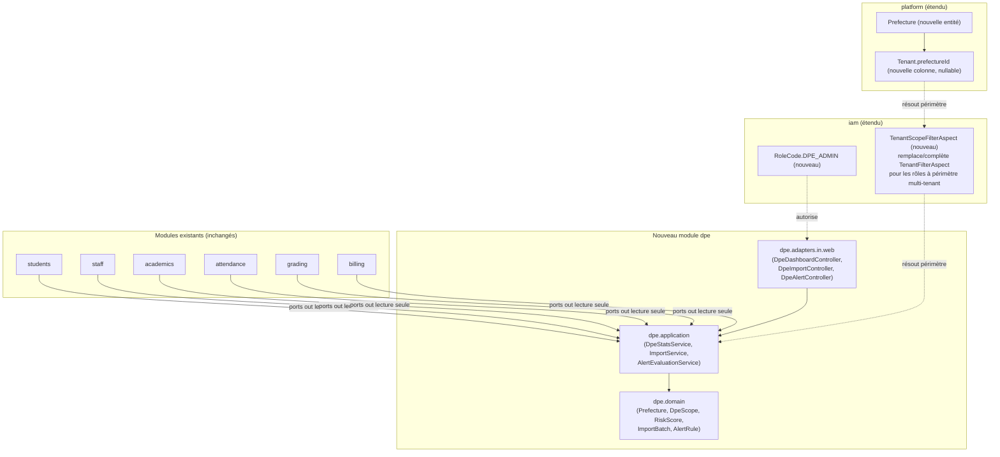
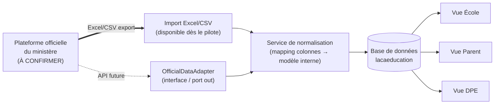

# Analyse d'architecture — Module de partenariat DPE

> Document produit conformément à `features/dpe.md` §23. Audit basé sur l'état réel du code au
> 2026-08-31 (Spring Modulith, backend `lacaeducation`, frontend `lacaeducation-ui`), pas sur les
> spécifications aspirationnelles d'autres documents du projet. Toute affirmation sur une éventuelle
> API du ministère est explicitement marquée **À CONFIRMER AVEC LE MINISTÈRE** — aucune n'est supposée
> exister.
>
> **État d'implémentation (mis à jour au fil de l'eau)** : la fondation sécurité décrite en §23.1 est
> livrée — rôle `DPE_ADMIN` (V137), table `prefectures` + `tenant.prefecture_id` +
> `dpe_user_prefectures` + mécanisme de résolution de périmètre `DpeScopeContext`/`DpeScopeProvider`
> (V139, contrôleur `PrefectureController` pour la gestion SUPER_ADMIN), et le journal d'audit
> transverse `audit_logs` (V140, module `audit`, couvrant pour l'instant authentification,
> rôles/permissions, cycle de vie des tenants et paiements/remboursements — non exhaustif, extensible
> sans changement de schéma). Le tableau de bord général (§13) est livré pour sa première tranche —
> nouveau module `dpe`, `GET /api/v1/dpe/dashboard|schools|schools/{id}`, frontend `/dpe/dashboard` et
> `/dpe/schools` — mais **limité aux effectifs** (écoles, élèves, enseignants, classes de l'année
> courante, ratio élèves/enseignant) ; il réutilise `StudentCountPort`/`TeacherCountPort` (nouveaux,
> mêmes conventions que l'existant) et `AcademicsDataProvider` (étendu) plutôt que de dupliquer une
> logique de comptage. Les alertes (§15) sont livrées pour leur première tranche — table `dpe_alerts`
> (V141), 5 règles dérivées des mêmes effectifs que le tableau de bord (école sans élève/enseignant/
> classe, école inactive, ratio élèves/enseignant élevé), réévaluées chaque nuit
> (`DpeAlertScheduler`, 5h) ou à la demande (`POST /api/v1/dpe/alerts/refresh`), avec
> résolution/réouverture automatique quand la condition disparaît/réapparaît ; changement de statut
> manuel (Nouvelle → En cours → Résolue) via `PATCH /api/v1/dpe/alerts/{id}/statut` ; frontend
> `/dpe/alerts`. La résolution de périmètre (DPE_ADMIN vs SUPER_ADMIN) a été factorisée dans
> `DpeScopeResolver`, partagé par le dashboard et les alertes — et `DpeScopeContext` porte maintenant
> aussi les préfectures affectées (pas seulement les tenants), nécessaire pour indexer les alertes par
> préfecture. **Reste à faire** : taux de présence, moyennes/résultats et score de risque de
> décrochage (§9-10 cahier des charges, §C spécification statistiques — nécessitent une agrégation
> supplémentaire non encore construite, actuellement absente plutôt que simulée) — et donc les alertes
> qui en dépendraient (taux d'absence anormal, absences répétées) ; les rapports (§16) ; la
> comparaison inter-écoles et la carte géographique (§12/§14).

## 1. Architecture actuelle

- **Backend** : Spring Boot / Spring Modulith, découpage hexagonal par module (`domain/`,
  `application/(port/in, port/out, service)`, `adapters/(in/web, out/persistence)`). Modules existants :
  `platform`, `iam`, `students`, `staff`, `academics`, `attendance`, `grading`, `billing`, `payments`,
  `payroll`, `webhooks`, `communication`, `reporting`, `portal`.
- **Frontend** : Next.js (`lacaeducation-ui`), App Router, une arborescence `/platform/...` déjà
  dédiée aux vues SUPER_ADMIN cross-tenant (`platform/dashboard`, `platform/tenants`,
  `platform/users`, `platform/subscriptions`, `platform/plans`, `platform/blog/*`).
- **Base de données** : PostgreSQL, migrations Flyway strictement additives (`V<n>__...sql`).
- **Multi-tenant** : `TenantContext` (ThreadLocal, `gn.lacaeducation.common.TenantContext`) +
  `TenantFilterAspect` (`iam/adapters/out/persistence/TenantFilterAspect.java`) qui active un
  `@Filter` Hibernate (`tenantFilter`, `defaultCondition = "tenant_id = :tenantId"`) sur chaque
  repository Spring Data, à condition que `TenantContext.get()` ne soit pas `null`. **Si le contexte
  est `null` (SUPER_ADMIN, jobs planifiés), le filtre reste désactivé et les requêtes deviennent
  cross-tenant** — c'est le seul mécanisme cross-tenant qui existe aujourd'hui, et il est **tout ou
  rien** (soit un seul tenant, soit tous).
- **Authentification** : JWT (`JwtService`), claims `sub` (userId), `roles[]`, `permissions[]`,
  `tenant_id` (absent pour SUPER_ADMIN). `TenantContextFilter` positionne le ThreadLocal après
  validation du token ; un en-tête `X-Tenant-Id` permet à un SUPER_ADMIN d'« impersonner » un tenant
  pour le support.
- **Rôles réellement codés** (`iam/domain/RoleCode.java`, `SecurityConfig.java`) : `SUPER_ADMIN`,
  `SCHOOL_ADMIN`, `DIRECTOR`, `RESPONSABLE_PEDAGOGIQUE`, `ACCOUNTANT`, `SECRETARY`, `TEACHER`,
  `PARENT`, `STUDENT`, `REDACTEUR` (blog uniquement). **Aucun rôle `DPE_ADMIN` n'existe.**
- **Autorisation** : `IamPermissionEvaluator` vérifie des permissions `ressource:action` — purement
  basé sur le rôle/permission, **sans notion de portée (scope) sur la ressource**. Le contrôle
  tenant-vs-ressource est fait **manuellement** dans certains contrôleurs (ex.
  `UserController.getById` compare `TenantContext.get()` au `tenantId` de l'entité) car le `@Filter`
  Hibernate ne s'applique pas aux lookups par clé primaire (`EntityManager.find`). C'est documenté
  comme limitation connue dans `iam/adapters/out/persistence/package-info.java`.
- **Entité `Tenant`** (`platform/domain/Tenant.java`) : `schoolName`, `slug`, `address`, `city`,
  `country`, `director`, `logo`, `brandColor`, `establishmentTypes` (enum multi-valué), `status`
  (PENDING_VERIFICATION/TRIAL/ACTIVE/SUSPENDED/EXPIRED/ARCHIVED/TERMINATED), pas de coordonnées
  géographiques (latitude/longitude), pas de champ région/préfecture.

**Constat central** : l'architecture actuelle n'a **aucune notion géographique ou hiérarchique
au-dessus du tenant**. Aucune occurrence de « région », « préfecture », « DPE », « district », « zone »
dans le code (grep exhaustif, zéro résultat). Le module DPE est donc une extension architecturale
réelle, pas un simple ajout de rôle.

## 2. Fonctionnalités existantes (réutilisables)

| Domaine | Existe déjà | Fichier(s) clé |
|---|---|---|
| Dashboards agrégés par école | `/dashboard/academic`, `/dashboard/finance`, `/dashboard/finance/projection`, `/dashboard/founder`, `/dashboard/hr`, `/dashboard/hr/performance` | `reporting/adapters/in/web/SchoolDashboardController.java` |
| Dashboard cross-tenant (précédent SUPER_ADMIN) | `/platform/dashboard` (KPIs plateforme : tenants, MRR/ARR, churn) | `platform/adapters/in/web/PlatformDashboardController.java`, `PlatformDashboardService.java` |
| Fournisseurs de statistiques par école | `SchoolAcademicStatsProvider`, `SchoolBillingStatsProvider`, `SchoolCollectionStatsProvider`, `SchoolPayrollStatsProvider` | module `reporting` |
| Génération PDF | OpenPDF (`com.github.librepdf:openpdf`), synchrone, ~10 générateurs existants (bulletins, factures, convocations, présences, fiches de paie, budget) | package `*/pdf/` par module |
| Stockage de documents | Cloudinary | `CloudinaryDocumentStorage` |
| Jobs planifiés (`@Scheduled`) | `SubscriptionRenewalScheduler`, `DeadlineCheckScheduler`, `AbsenceAutoMarkScheduler` | modules `platform`, `billing`, `attendance` |
| Import CSV élèves | `POST /students/import`, multipart, mapping d'en-têtes insensible à la casse, rapport d'erreurs par ligne | `StudentImportService`, `StudentController.java` |
| Calcul de moyennes/rangs | Chaîne complète et configurable (formules par catégorie COURS/COMPOSITION), 100% interne | `grading/domain/SubjectAverageCalculator.java`, `GradingFormulaEngine.java`, `application/service/GradeCalculationService.java` |
| Clôture de période (verrouillage des notes) | Champ `Periode.closed` | `academics/domain/Periode.java` |
| Présences élèves et enseignants | Tables **distinctes** `StudentAttendance` / `TeacherAttendance`, avec motif, justification, retard en minutes | `attendance/domain/*` |
| Effectif de classe fiable | Recalculé automatiquement depuis les inscriptions validées (`Enrollment.status = VALIDATED`) via un event listener | `academics/application/listener/EnrollmentEventListener.java` |
| Précédent UI cross-tenant | Arborescence `/platform/...` déjà en place côté frontend | `lacaeducation-ui/src/app/(app)/platform/*` |

## 3. Fonctionnalités manquantes

- **Aucune hiérarchie géographique** (Ministère → Direction Régionale → DPE → École) — à construire
  entièrement.
- **Aucun mécanisme de filtre cross-tenant partiel** (« voir un sous-ensemble de tenants ») — le
  `TenantFilterAspect` actuel ne connaît que « un tenant » ou « tous les tenants ».
- **Aucun rôle `DPE_ADMIN`**, ni notion de périmètre associé à un utilisateur.
- **Aucune `AuditLog`** : le système actuel utilise des événements Spring applicatifs ponctuels
  (`UserLoggedInEvent`, `RoleAssignedEvent`, etc.), pas de table d'audit consultable, pas d'endpoint
  `/audit-logs`. C'est un manque bloquant pour §16 du cahier des charges (données sensibles sur des
  mineurs).
- **Aucun import Excel (.xlsx)** — seul un import CSV minimal existe, sans dry-run, sans détection de
  doublons, **sans idempotence** (réimporter le même fichier crée des doublons) et sans historique
  d'import. Le cahier des charges DPE (§4) exige les 18 points ; environ 3/18 sont couverts
  partiellement (upload, mapping basique par en-tête, rapport d'erreurs par ligne).
- **Aucun endpoint `/exports/...`** générique.
- **Aucune intégration avec un système externe du ministère** — ni adaptateur, ni configuration, ni
  mention dans le code. **À CONFIRMER AVEC LE MINISTÈRE** : existence, format et accessibilité d'une
  API officielle.
- **Aucun scoring de risque de décrochage** — seul le taux de présence enseignant est calculé
  aujourd'hui (à la volée, pas en cache) ; le taux de présence élève n'est même pas pré-calculé.
- **`ClasseMatiere` n'est pas versionnée par année scolaire** — une réaffectation écrase l'existant,
  aucun historique. Contredit directement §9 et §14 du cahier des charges (« ne jamais écraser
  l'historique »).
- **Aucun champ « heures prévues »/« heures réalisées »** stocké — dérivable de `EmploiDuTemps`
  (prévu) mais pas de source fiable pour le réalisé en dehors des présences enseignant.
- **Coordonnées géographiques des écoles absentes** — la carte de préfecture (§14) ne peut pas être
  construite sans les ajouter.

## 4. Architecture proposée

Approche **additive**, cohérente avec l'architecture Modulith existante : un nouveau module `dpe`
(hexagonal, comme les autres), qui **consomme en lecture seule** les ports de sortie déjà exposés par
`students`, `staff`, `academics`, `attendance`, `grading`, `billing` — sans jamais les modifier — plus
un mécanisme de filtrage multi-tenant étendu (voir §6).

## 5. Modèle de données (nouvelles tables, additif uniquement)

Toutes les migrations seront de nouveaux fichiers `V<n>__...sql` (jamais de modification d'une
migration existante).

- **`prefectures`** (module `platform`, car symétrique à `Tenant`) : `id, nom, type
  (DPE/DCE), region, pays, latitude, longitude, statut (ACTIVE/ARCHIVEE), created_at`. Le champ
  `type` distingue une **DPE** (Direction Préfectorale de l'Éducation, périmètre = préfecture) d'une
  **DCE** (Direction Communale de l'Éducation, périmètre = commune — utilisé notamment à Conakry, qui
  est découpée en communes et non en préfectures). Les deux partagent exactement le même modèle de
  données et le même mécanisme de périmètre (§7) — seul le libellé affiché à l'écran change selon le
  `type` (« Tableau de bord DPE » vs « Tableau de bord DCE »).
- **`tenants.prefecture_id`** (colonne ajoutée, nullable, `REFERENCES prefectures(id)`) — un tenant
  peut ne pas être rattaché à une DPE/DCE (écoles hors pilote).
- **`dpe_users`** (module `iam` ou `platform`) : lie un `User` à un rôle `DPE_ADMIN` et à un ou
  plusieurs `prefecture_id` (table de jonction `dpe_user_prefectures` si un utilisateur DPE devait un
  jour couvrir plusieurs préfectures — cf. §7 du cahier des charges, évolutivité vers Direction
  Régionale/Ministère).
- **`teacher_assignments`** (module `academics`, **remplace le rôle informationnel de
  `ClasseMatiere` pour l'historique**, sans supprimer `ClasseMatiere`) : `id, tenant_id, teacher_id,
  school_class_id, subject_id, academic_year_id, coefficient, code, date_debut, date_fin (nullable),
  created_by_user_id`. `ClasseMatiere` reste la source de vérité pour l'affectation **courante**
  (utilisée par la saisie de notes, l'emploi du temps, etc.) ; `teacher_assignments` est peuplée en
  parallèle (event listener sur création/modification/suppression de `ClasseMatiere`) pour fournir
  l'historique demandé en §9/§14 sans toucher au fonctionnement existant.
- **`import_batches`** (nouveau module `dpe` ou `students`, réutilisable au-delà du DPE) : `id,
  tenant_id, type (ELEVES/NOTES/ENSEIGNANTS/RESULTATS_OFFICIELS), fichier_original_url,
  colonnes_detectees (jsonb), mapping_colonnes (jsonb), statut (BROUILLON/PREVISUALISE/CONFIRME/
  ECHOUE), nb_lignes, nb_crees, nb_maj, nb_erreurs, hash_fichier (pour l'idempotence), importe_par
  (user_id), importe_le, rapport_erreurs (jsonb ou lien fichier)`.
- **`import_batch_rows`** (détail ligne par ligne, pour le rapport d'erreurs et la ré-importation
  après correction) : `id, batch_id, numero_ligne, donnees_brutes (jsonb), statut
  (VALIDE/ERREUR/DOUBLON), message_erreur`.
- **`dpe_alerts`** : `id, prefecture_id, tenant_id (nullable si alerte préfecture-wide), classe_id
  (nullable), type, priorite (BASSE/MOYENNE/HAUTE), description, statut
  (NOUVELLE/EN_COURS/RESOLUE), created_at, resolved_at, resolved_by_user_id`.
- **`audit_logs`** (transverse, hors périmètre strict DPE mais **prérequis de sécurité** exigé par
  §16 — voir §18) : `id, tenant_id (nullable pour actions plateforme), utilisateur_id, action,
  ressource, ressource_id, details (jsonb), adresse_ip, user_agent, created_at`.
- **`student_risk_scores`** (cache calculé, régénéré par job planifié — voir §14/§20 statistiques) :
  `id, tenant_id, student_id, periode_id, score, niveau (VERT/ORANGE/ROUGE), facteurs (jsonb),
  calcule_le`.

## 6. Architecture multi-écoles

Déjà largement en place : chaque école = un `Tenant`, isolation stricte via `TenantContext` +
`@Filter`. Ce mécanisme **reste inchangé** pour tous les rôles existants (SCHOOL_ADMIN, TEACHER,
PARENT, etc.). Le module DPE ne le remplace pas, il l'**étend** pour un nouveau cas d'usage : un
utilisateur qui doit voir plusieurs tenants à la fois, mais pas tous.

## 7. Architecture multi-DPE/DCE (et au-delà : région, ministère)

Le modèle proposé (`prefectures` + `tenants.prefecture_id` + `dpe_user_prefectures`) supporte
nativement l'évolutivité demandée en §6 du cahier des charges, ainsi que la coexistence DPE/DCE :

- **DPE ou DCE** : un utilisateur `DPE_ADMIN` (même rôle pour les deux, seul `prefecture.type`
  change) lié à une seule `prefecture_id` (cas pilote).
- **Direction Régionale** (futur) : ajouter `prefectures.region_id` + une table `regions`, et un rôle
  `REGIONAL_ADMIN` dont le périmètre est résolu comme « toutes les préfectures de sa région » — même
  mécanisme de résolution de périmètre, une couche de plus.
- **Ministère/Administrateur national** (futur) : équivalent à un SUPER_ADMIN actuel mais scopé aux
  données pédagogiques (pas à l'administration SaaS de la plateforme, qui reste un système distinct) —
  périmètre = toutes les préfectures.

**Mécanisme de résolution de périmètre (nouveau, remplace/complète `TenantFilterAspect` pour ces
rôles)** : au lieu d'un `tenant_id` unique dans le JWT, le token d'un `DPE_ADMIN` porte un
`prefecture_id` (pas un `tenant_id`). Un nouveau `DpeScopeContext` (ThreadLocal, même pattern que
`TenantContext`) est peuplé par `TenantContextFilter` (étendu) avec la liste des `tenant_id` de la
préfecture (résolue une fois par requête via `TenantRepository.findByPrefectureId`). Les requêtes du
module `dpe` utilisent explicitement cette liste (`WHERE tenant_id IN (:ids)`) plutôt que de dépendre
du `@Filter` Hibernate implicite — **par choix**, pour que le périmètre DPE soit toujours explicite et
auditable dans le code, jamais un effet de bord silencieux d'un filtre désactivé (contrairement au
mécanisme actuel du SUPER_ADMIN, dont le comportement « `null` = tout voir » est risqué à répliquer
pour un périmètre partiel).

## 8. Système de rôles

- Nouveau `RoleCode.DPE_ADMIN`, ajouté à l'enum existant et à `SecurityConfig`.
- Permissions dédiées au format déjà en usage (`ressource:action`), ex. `dpe:dashboard:read`,
  `dpe:school:read`, `dpe:teacher:read`, `dpe:alert:read`, `dpe:alert:update`, `dpe:report:export`,
  `dpe:import:create`. Aucune permission d'écriture sur les données pédagogiques des écoles (cf. §16
  du cahier des charges — « ne peut pas modifier »).
- `IamPermissionEvaluator` n'a pas besoin de changer (vérification de permission déjà générique) ;
  c'est la **résolution du périmètre** (§7) qui est nouvelle, pas le modèle de permission.

## 9. API nécessaires

En reprenant la convention déjà établie (`/api/v1`, pagination `{content, page, size,
totalElements, totalPages}`, RFC 7807 pour les erreurs) et le préfixe `/platform/...` réservé au
SUPER_ADMIN, on introduit un préfixe **`/api/v1/dpe/...`** dédié (ni tenant-scopé au sens classique,
ni plateforme-SaaS) :

- `GET /api/v1/dpe/dashboard` — vue générale préfecture (§7 cahier des charges).
- `GET /api/v1/dpe/schools?statut=&search=` — écoles du périmètre.
- `GET /api/v1/dpe/schools/{tenantId}/statistics?periode=` — stats d'une école (vérifie que
  `tenantId` appartient au périmètre DPE courant → 403 sinon).
- `GET /api/v1/dpe/schools/{tenantId}/classes/{classId}/statistics`
- `GET /api/v1/dpe/schools/{tenantId}/teachers` — corps enseignant d'une école.
- `GET /api/v1/dpe/teachers/{teacherId}` — fiche enseignant (vérifie l'école du prof ∈ périmètre).
- `GET /api/v1/dpe/teachers/statistics` — vue RH consolidée (§11 module enseignants).
- `GET /api/v1/dpe/compare?schoolIds=` — comparaison d'écoles (§12).
- `GET /api/v1/dpe/alerts?statut=&priorite=` / `PATCH /api/v1/dpe/alerts/{id}` (changement de statut
  uniquement, jamais de suppression).
- `GET /api/v1/dpe/reports/monthly?mois=` / `GET /api/v1/dpe/reports/school/{tenantId}` /
  `GET /api/v1/dpe/reports/annual` — génération PDF/Excel asynchrone (réutilise l'infra OpenPDF).
- `POST /api/v1/dpe/imports/official-results` — upload d'un fichier (Excel/CSV) de résultats
  officiels pour une école du périmètre.
- `GET /api/v1/dpe/imports` / `GET /api/v1/dpe/imports/{id}` / `GET /api/v1/dpe/imports/{id}/errors`
  — historique et détail d'un import (réutilisable aussi côté `SCHOOL_ADMIN` pour ses propres imports,
  d'où le choix de loger `import_batches` sans dépendance dure au module `dpe`).

Les exemples de routes du cahier des charges (§18, `/api/dpe/...` sans `/v1`) sont adaptés à la
convention réelle du projet (`/api/v1/dpe/...`), conformément à l'instruction de ne pas les copier
aveuglément.

## 10. Système d'import Excel

Voir le modèle de données (§5, `import_batches`/`import_batch_rows`). Pipeline proposé, en 4 étapes
HTTP distinctes pour permettre l'aperçu avant confirmation (exigence §4.11-12) :

1. `POST /dpe/imports/official-results` (fichier seul) → parsing + détection des colonnes → crée un
   `ImportBatch` en statut `BROUILLON`, retourne les colonnes détectées + un mapping proposé
   (correspondance approximative par nom d'en-tête, comme le fait déjà `StudentImportService` pour le
   CSV élèves).
2. `PUT /dpe/imports/{id}/mapping` (l'admin corrige le mapping colonne → champ).
3. `POST /dpe/imports/{id}/preview` → valide chaque ligne (élève connu/inconnu, classe connue/inconnue,
   note dans les bornes, doublon) sans rien écrire, statut `PREVISUALISE`, retourne le rapport.
4. `POST /dpe/imports/{id}/confirm` → écrit réellement les données, statut `CONFIRME`.

**Idempotence** : `hash_fichier` (SHA-256 du contenu) unique par tenant+type ; un ré-upload du même
fichier renvoie le batch existant plutôt que d'en créer un nouveau. Bibliothèque recommandée pour le
parsing Excel : **Apache POI** (`.xlsx`) — absente du projet aujourd'hui, à ajouter en dépendance
(le CSV existant restant supporté en parallèle, format le plus probable pour un export ministériel
selon les écoles).

## 11. Stratégie d'intégration API officielle

**Aucune API officielle du ministère n'est connue ou accessible à ce jour — À CONFIRMER AVEC LE
MINISTÈRE.** Le code ne contient aucune trace d'une telle intégration (confirmé par l'audit du module
`grading` : calcul 100% interne, aucun client HTTP externe, aucune configuration `application.yml`
pointant vers un système ministériel).

Architecture proposée, **abstraite et prête à recevoir une API le jour où elle existera**, sans rien
supposer de son contrat :

`OfficialDataAdapter` est un port de sortie (`application/port/out`) avec une seule implémentation
initiale : `ExcelOfficialDataAdapter` (Scénario B, §4/§12). Le jour où une API officielle est
confirmée, une seconde implémentation `MinistryApiOfficialDataAdapter` peut être ajoutée sans changer
le reste du pipeline (normalisation, DB, vues) — c'est l'objet du document
`OFFICIAL_SYSTEM_INTEGRATION.md`.

## 12. Stratégie fallback Excel

C'est la stratégie **par défaut et unique pour le pilote** (voir §11 — aucune API confirmée). Détail
au §10 ci-dessus et dans `OFFICIAL_SYSTEM_INTEGRATION.md`.

## 13. Dashboard DPE

Voir `DPE_STATISTICS_SPECIFICATION.md` pour le détail des indicateurs. Réutilise le pattern déjà
établi de `SchoolDashboardController`/`*StatsProvider` (agrégation via ports de sortie des modules
métier), mais les requêtes portent sur **plusieurs tenants** (liste résolue par le périmètre DPE, §7)
au lieu d'un seul. Réutilise également le précédent frontend `/platform/dashboard` comme modèle de
mise en page cross-tenant côté UI (nouvelle route `/dpe/dashboard`).

## 14. Statistiques

Document dédié : `DPE_STATISTICS_SPECIFICATION.md`.

## 15. Système d'alertes

Table `dpe_alerts` (§5). Génération majoritairement par jobs planifiés (suivant le pattern
`DeadlineCheckScheduler`/`AbsenceAutoMarkScheduler` déjà en place) qui évaluent périodiquement les
règles du cahier des charges §13 (taux d'absence anormal, absence de synchronisation prolongée,
incohérence d'effectifs, etc.) et créent/mettent à jour les lignes `dpe_alerts` correspondantes.
Console de gestion (`GET/PATCH /dpe/alerts`) pour le changement de statut NOUVELLE → EN_COURS →
RESOLUE, avec historique conservé (append, jamais de suppression).

## 16. Système de rapports

Réutilise directement l'infrastructure OpenPDF existante (§2) : ajout de nouveaux générateurs
(`OpenPdfDpeMonthlyReportGenerator`, `OpenPdfDpeSchoolReportGenerator`,
`OpenPdfDpeAnnualReportGenerator`) suivant exactement le même pattern que les générateurs existants
(en-tête/pied de page communs `SchoolPdfHeader`/`SchoolPdfPageFooter`, adaptés avec le branding DPE
plutôt qu'école). Export Excel/CSV : nouvelle brique à créer (aucun export existant aujourd'hui,
cf. §3) — bibliothèque recommandée : Apache POI (déjà nécessaire pour l'import, §10) pour la
génération `.xlsx` également, réutilisation immédiate de la dépendance.

## 17. Sécurité

- **Contrôle d'accès par périmètre** : chaque endpoint `/dpe/...` vérifie explicitement que la
  ressource demandée (tenant, classe, enseignant) appartient au périmètre résolu de l'utilisateur
  (§7) — jamais une confiance implicite dans un `@Filter` Hibernate global, pour les raisons
  exposées en §7.
- **Journalisation des accès et exports** : nécessite la nouvelle table `audit_logs` (§5, §18) —
  **prérequis bloquant** avant tout déploiement pilote, puisque les données concernent des mineurs.
- **Aucune donnée nominative dans les logs applicatifs** : audit du code de logging à faire lors de
  l'implémentation (non vérifié dans cet audit, à traiter phase par phase).
- **Anonymisation des exports** : les rapports DPE agrégés (§15 cahier des charges) ne doivent
  exposer des données nominatives d'élèves que si le rôle le permet explicitement ; prévoir un mode
  d'export « agrégé uniquement » par défaut.
- **Fichiers importés** : stockage temporaire chiffré ou purge automatique après traitement
  (`import_batches.fichier_original_url` pointant vers un stockage à rétention limitée, ex.
  Cloudinary avec règle d'expiration, ou suppression applicative après confirmation + délai de grâce).
- **RGPD / réglementation locale** : le RGPD ne s'applique pas automatiquement à la Guinée. **À
  CONFIRMER** : cadre légal guinéen sur la protection des données personnelles des mineurs (loi
  applicable, autorité de contrôle le cas échéant). En l'absence de confirmation, appliquer par
  défaut les principes les plus protecteurs (minimisation des données, durée de conservation limitée,
  consentement/information des parents) sans présenter cela comme une conformité RGPD formelle.

## 18. Audit/logging

Comme indiqué en §3 et §17, **aucune table d'audit générique n'existe aujourd'hui**. Il faut créer :

- `audit_logs` (§5) — table transverse, pas spécifique au module DPE mais **condition préalable** à
  un déploiement DPE responsable (accès à des données de mineurs par un tiers externe à l'école).
- Un `AuditLogService` (nouveau, module `iam` ou nouveau module `audit`) écouté par événement Spring
  (le mécanisme d'événements existe déjà — `UserLoggedInEvent`, etc. — il suffit d'ajouter un listener
  qui persiste au lieu de rester ponctuel) plutôt que de dupliquer l'appel de journalisation dans
  chaque contrôleur.
- Endpoints `GET /api/v1/audit-logs` (école, scope tenant) et `GET /api/v1/platform/audit-logs`
  (plateforme) — et pour la DPE, un accès en lecture aux logs **concernant ses propres accès et
  exports**, jamais aux logs internes des écoles.

## 19. Plan de migration

Aucune migration de données existante n'est nécessaire pour le lancement (le module est additif). Les
seules étapes de « migration » sont :
1. Attribution manuelle des `tenants.prefecture_id` pour les écoles pilotes (script ou UI SUPER_ADMIN).
2. Création du compte `DPE_ADMIN` pilote, lié à la préfecture correspondante.
3. Aucune donnée historique à rétro-remplir dans `teacher_assignments` n'est fiable au-delà de l'année
   scolaire courante (`ClasseMatiere` actuel n'a pas d'historique) — l'historique démarre à
   l'activation de la fonctionnalité, ce qui doit être communiqué clairement au client (pas
   d'historique rétroactif garanti).

## 20. Plan de déploiement pilote

1. Sélectionner 3 à 5 écoles volontaires déjà tenants actifs de la plateforme, les rattacher à la
   `prefecture` « Coyah ».
2. Activer le rôle `DPE_ADMIN` pour un seul compte pilote (le Directeur Préfectoral ou un délégué).
3. Démarrer avec le dashboard général (§13/§7 cahier des charges) + statistiques par école (§8) avant
   d'activer les fonctionnalités plus lourdes (comparaison, cartographie).
4. **Import Excel des résultats officiels du ministère : optionnel, pas un prérequis du pilote**
   (confirmé par le client — c'est une piste d'enrichissement future, pas une obligation). Le pilote
   peut démarrer et rester utile uniquement avec les statistiques déjà natives à la plateforme
   (présence, effectifs, alertes) sans jamais importer de résultat officiel. Si cette brique est
   activée un jour, elle ne le sera qu'après validation du format réel des exports du ministère avec
   au moins une école pilote (le format n'est pas connu à l'avance, §26).
5. Alertes et rapports activés en dernier, une fois les statistiques de base validées par le pilote.

## 21. Risques techniques

- **Le mécanisme de périmètre multi-tenant (§7) est un ajout architectural non trivial** : toute
  erreur dans sa résolution expose des données d'école à une DPE qui ne devrait pas les voir — code
  review et tests d'intrusion spécifiques nécessaires avant mise en production.
- **Absence totale d'`AuditLog`** aujourd'hui : livrer le module DPE sans cette fondation serait une
  régression de sécurité pour une fonctionnalité qui donne justement accès à un tiers externe.
- **`ClasseMatiere` non versionnée** : le double-écriture vers `teacher_assignments` (§5) doit être
  fiable dès le premier jour, sinon l'historique enseignant sera faux dès le départ.
- **Performance des agrégations cross-tenant** : les `*StatsProvider` actuels sont conçus pour un
  tenant à la fois ; les versions DPE devront être testées à l'échelle de plusieurs écoles
  (indexation sur `tenant_id` déjà en place, mais requêtes `IN (...)` à valider en charge).

## 22. Risques liés aux données

- **Hétérogénéité des référentiels `Niveau`** : chaque tenant définit ses propres lignes `Niveau`
  (label + cycle), il n'existe **aucune table de référence partagée entre tenants**. Une agrégation
  « effectif par niveau » à l'échelle DPE devra regrouper par `cycle` (valeur d'enum partagée) et non
  par le libellé texte du niveau, sous peine de compter séparément un « CM2 » et un « Cours Moyen 2 »
  saisis différemment par deux écoles.
- **Qualité des imports Excel** : sans validation stricte (§10), des données incohérentes (élèves
  inconnus, classes inconnues) peuvent corrompre les statistiques DPE — la phase d'aperçu/confirmation
  est non négociable.
- **Absences de données non-significatives à tort** : une école qui n'a simplement pas encore saisi
  ses présences ne doit pas apparaître comme ayant un excellent taux de présence (0 absence
  enregistrée ≠ 100% de présence réelle) — les statistiques doivent toujours être accompagnées d'un
  indicateur de complétude/fraîcheur des données (voir `DPE_STATISTICS_SPECIFICATION.md`).

## 23. Recommandations

1. Démarrer par la fondation technique (rôle `DPE_ADMIN`, `prefectures`, résolution de périmètre,
   `audit_logs`) avant tout dashboard visible — c'est la partie la plus risquée en sécurité et la
   moins visible commercialement, elle doit être solide en premier.
2. Ne pas construire l'intégration API ministérielle avant confirmation qu'elle existe (§11). L'import
   Excel des résultats officiels lui-même est **optionnel** (confirmé par le client, §20) — le pilote
   se construit d'abord sur les statistiques natives à la plateforme (présence, effectifs, alertes),
   l'import Excel restant une piste à activer plus tard si le besoin se confirme.
3. Limiter le pilote à un périmètre géographique unique (Coyah) et un nombre restreint d'écoles avant
   d'envisager la hiérarchie région/ministère (§7), qui reste une extension architecturale et non un
   prérequis du pilote.
4. Traiter le versionnement de `ClasseMatiere` (`teacher_assignments`) tôt, car plus le pilote dure
   sans historique, plus la valeur du module de supervision enseignant (§9 cahier des charges) est
   compromise a posteriori.
5. Ne jamais présenter le score de risque de décrochage ou les comparaisons inter-écoles comme un
   jugement de qualité — les libellés UI doivent porter cette nuance explicitement, conformément aux
   avertissements du cahier des charges (§10, §12, §16 module enseignants).
